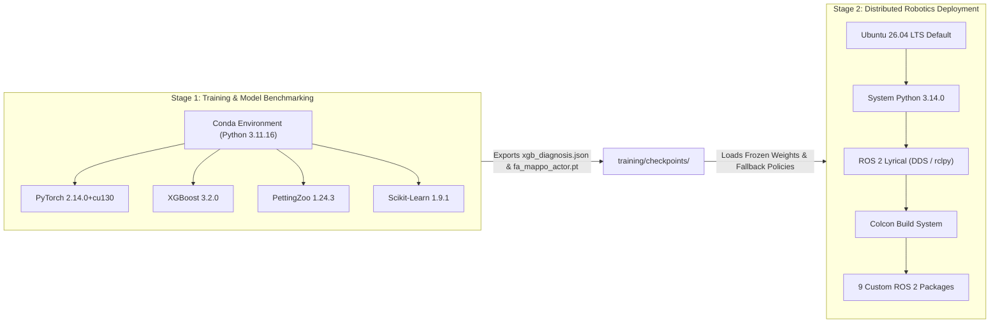

# Technology Stack & Computational Architecture Specifications

This document outlines the complete hardware, software, networking, and runtime specifications powering the **Fault-Aware Multi-Agent USV Swarm**.

---

## 1. Computational Platform & Hardware Envelope

The system is designed for deployment on edge maritime computers (e.g., NVIDIA Jetson Orin / x86 marine mission computers) and was validated on an enterprise development workstation.

| Hardware Subsystem | Specification | Operational Envelope |
| :--- | :--- | :--- |
| **Host Processor (CPU)** | 8+ Physical Cores @ 3.80 GHz | Multi-threaded ROS 2 executor running 7 concurrent nodes at 20 Hz (< 18% total CPU load). |
| **Graphics Processing (GPU)** | NVIDIA GeForce RTX 3060 (12 GB GDDR6) | PyTorch CUDA 13.0 acceleration for FA-MAPPO policy training and fast vectorized rollout. |
| **VRAM Utilization** | Allocated < 850 MB | Low footprint allows co-existence with onboard vision/lidar SLAM pipelines. |
| **Host System Memory (RAM)** | 32 GB DDR4 | Entire 6-USV ROS 2 simulation consumes < 2.2 GB resident set memory. |
| **Storage & I/O** | NVMe PCIe Gen4 SSD | High-throughput logging of high-frequency rosbag / telemetry traces. |
| **Network Interface** | Simulated Ad-Hoc Maritime WiFi / Mesh | Simulated 5.8 GHz wireless ad-hoc mesh with up to 40% packet drop and 80 ms latency. |

---

## 2. Operating System & Dual-Runtime Architecture

To balance modern GPU deep learning toolchains with bleeding-edge robotic middleware, the architecture employs an isolated **Dual-Runtime Environment Strategy**:



### 2.1 Rationale for Dual-Runtime Python Isolation
1. **Ubuntu 26.04 System Python (3.14):**
   - ROS 2 Lyrical is built natively against `/usr/bin/python3` (Python 3.14).
   - Core robotics packages (`rclpy`, `sensor_msgs`, `geometry_msgs`, `builtin_interfaces`) execute natively without C-ABI mismatch.
2. **Dedicated Conda Machine Learning Runtime (`usv_swarm_env`, Python 3.11):**
   - High-performance machine learning frameworks (PyTorch with CUDA acceleration, GPU-accelerated XGBoost, Scikit-learn, and PettingZoo) maintain official wheels and stable ABI compatibility under Python 3.11.
   - Stage 1 training scripts, vectorized PettingZoo environments, and automated regression test suites run strictly inside `/home/pritish_3110/miniconda3/envs/usv_swarm_env`.
3. **Cross-Runtime Model Interoperability:**
   - XGBoost models are serialized to standardized, platform-independent JSON (`xgb_diagnosis.json`), allowing parsing across runtimes.
   - Neural policies are serialized to TorchScript / PyTorch weight checkpoints (`fa_mappo_actor.pt`).
   - The ROS 2 nodes (`diagnosis_node.py` and `marl_policy_node.py`) include self-contained analytical and feature-matching fallbacks ensuring deterministic real-time execution even when running under system Python 3.14.

---

## 3. Software Dependency Matrix

| Category | Component / Library | Version | Role in Project |
| :--- | :--- | :--- | :--- |
| **Robotics Middleware** | ROS 2 Lyrical | 2026 Distribution | Inter-node IPC, lifecycle management, publish-subscribe message passing. |
| **Build System** | colcon-core | 0.16.0+ | Symlink-installed multi-package workspace compilation. |
| **Build Tooling** | ament_python / ament_cmake | — | ROS 2 build tools for custom messages and Python nodes. |
| **Deep Reinforcement Learning** | PyTorch (`torch`) | 2.14.0+cu130 | FA-MAPPO actor-critic network forward inference and gradient descent. |
| **Multi-Agent Simulation** | PettingZoo | 1.24.3 | Vectorized `ParallelEnv` simulating multi-agent USV interactions. |
| **Gymnasium** | Gymnasium | 0.29.1 | RL action/observation space specifications. |
| **Fault Diagnosis (FDI)** | XGBoost | 3.2.0 | Multi-class gradient boosted decision trees for real-time fault identification. |
| **Statistical Analysis** | Scikit-Learn | 1.9.1 | Confusion matrices, classification reports, and cross-validation pipelines. |
| **Scientific Computing** | NumPy / SciPy | 1.26.4 / 1.13.0 | RK4 integration, matrix algebra, Hungarian bipartite matching algorithm. |
| **Testing Framework** | PyTest | 9.1.1 | Automated regression test runner (`tests/test_swarm_core.py`). |
| **Cloud Tactical Arbiter** | Groq Python SDK | 0.18.0+ | Low-latency inference client connecting to cloud LPUs running `openai/gpt-oss-120b`. |
| **Data Validation** | Pydantic | 2.10+ | Structured JSON schema enforcement for tactical arbitration responses. |

---

## 4. Custom ROS 2 Interface Definitions (`usv_msgs`)

The swarm communicates over strongly-typed custom DDS messages defined in `src/usv_msgs`:

```
src/usv_msgs/msg/
├── USVState.msg         # Odometry (x, y, psi), velocities (u, v, r), actuator commands, thrust efficiency
├── HealthBelief.msg     # Sliding-window features, class probabilities, composite health index h_i(t)
├── RoleAssignment.msg   # Assigned role (tracker/interceptor/relay/scout), target coordinate, degraded flag
├── TargetBelief.msg     # Fused target estimate (x, y, u, v, psi) with covariance from gossip mesh
├── MissionStatus.msg    # Fleet encirclement metrics: angular spread, max gap, arrest status, collision count
└── RecoveryEvent.msg    # Tactical anomaly payload emitted to the Groq LLM Arbiter
```

### Detailed Message Schema:

#### 1. `usv_msgs/msg/HealthBelief.msg`
```text
std_msgs/Header header
uint32 agent_id
float64 health_index          # Composite health h_i in [0.0, 1.0]
string diagnosed_fault        # "HEALTHY", "GPS_FAULT", "THRUSTER_FAULT", "LINK_LOSS"
float64 prob_healthy
float64 prob_gps_fault
float64 prob_thruster_fault
float64 prob_link_loss
float64 thrust_efficiency     # Actuator effectiveness ratio in [0.0, 1.0]
float64 gps_noise_std         # Estimated GPS sensor variance (m)
float64 link_packet_loss_rate # Network dropout fraction in [0.0, 1.0]
```

#### 2. `usv_msgs/msg/RoleAssignment.msg`
```text
std_msgs/Header header
uint32 agent_id
string role                  # "tracker", "interceptor", "relay", "scout"
geometry_msgs/Point target_slot # Assigned coordinate around target
float64 assigned_radius      # 20m (ring), 30m (relay), 45m (scout)
bool is_degraded_reallocation # True if assigned to mitigate health fault
```

#### 3. `usv_msgs/msg/MissionStatus.msg`
```text
std_msgs/Header header
uint32 total_agents
uint32 healthy_agents
uint32 degraded_agents
uint32 participating_trackers
float64 standoff_radius_mean # Target: 20.0 m (+/- 3.0 m)
float64 angular_spread       # Criterion 1: >= 2*pi*(1 - 1/N)
float64 max_angular_gap      # Criterion 2: <= (2*pi/N) * 1.5
bool criterion_1_satisfied
bool criterion_2_satisfied
bool target_arrested         # Speed < 0.20 m/s or dwell >= 10.0 s
bool encirclement_achieved   # Section 5 pass state
bool zero_collision_invariant# True if d_min >= 4.0 m for all pairs
uint32 collision_count
```

---

## 5. Network Topology & Gossip Protocol

1. **Distributed Ad-Hoc Gossip:**
   - USVs do not rely on a single vulnerable central base station.
   - Each agent broadcasts local target observations and neighbor states over a range-limited radio mesh ($R_{comm} = 60.0\,	ext{m}$).
2. **Channel Degradation Simulation:**
   - `usv_fault_injector` and `usv_perception_mesh` simulate stochastic packet loss (up to 40%) using Bernoulli and Gilbert-Elliott loss models.
   - Extended Kalman Filters (EKF) locally bridge communication gaps by predicting target kinematics during message outages.

---

## 6. Security, Safety, & Environment Guardrails

1. **Credential Isolation:**
   - Groq API credentials reside strictly in root environment files (`.env`).
   - The codebase strictly prohibits automated tools or subagents from altering, viewing, or transmitting `.env` contents.
2. **Deterministic Hard Safety Override:**
   - The Control Barrier Function (CBF) filter operates at 20 Hz as a hard gatekeeper between policy outputs and low-level actuators.
   - Even in the event of an LLM timeout, neural policy explosion, or network disconnect, the analytical CBF filter overrides commands to maintain $d_{ij} \ge 4.0\,	ext{m}$.
